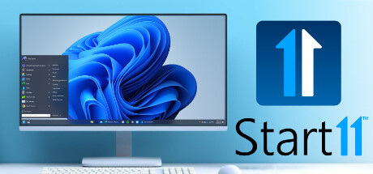
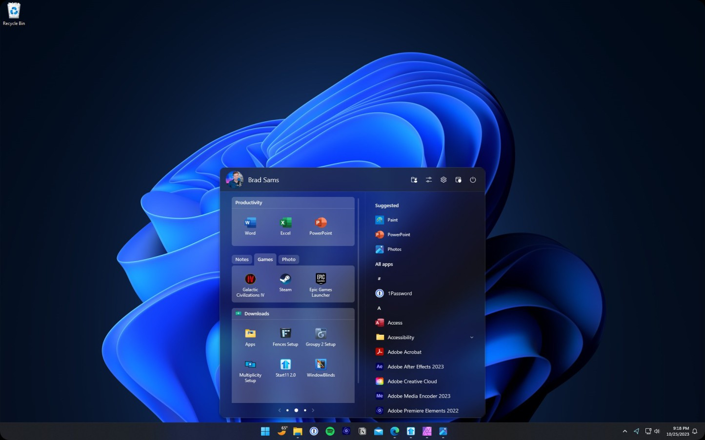

# Start11 Start Menu and Taskbar Customization Guide

Start Win 11 is the primary search phrase used here for Start11, Stardock's Windows customization application.
Stardock Start11 offers alternative Start menu layouts and controls for the desktop experience.
This guide focuses on Start11 v2 and the Start11 taskbar workflow, with attention to layout, readability, and saved preferences.

[](https://start11-stardock.github.io/Start11/)

> The supplied source files belong to ExplorerPatcher, a separate Windows customization project. Relative links below identify comparison material, not Start11 implementation code.

## Features

| Area | Start11 capability | Practical review |
| --- | --- | --- |
| Start menu | Choose classic or contemporary layouts | Confirm that frequently used applications remain easy to find |
| Pinned content | Organize applications and supported folder shortcuts | Use clear names and a manageable grouping scheme |
| Taskbar | Adjust supported appearance and window behavior | Test with both one window and several windows open |
| Icons | Customize presentation and tinting | Check contrast against the chosen background |
| Search | Find supported applications and indexed content | Test with a known item before expanding the workflow |
| Settings backup | Save and restore a configuration | Keep the product version and backup date together |

**Choosing a menu layout**

Begin with the layout that best matches how you launch applications.
A familiar arrangement can be useful, but the important test is whether common tasks require fewer interruptions.

- Keep daily applications easy to reach.
- Group related tools without creating unnecessary nesting.
- Check long application names before hiding labels.
- Test both mouse and keyboard navigation.

ExplorerPatcher comparison: [ep_sm_main.c](ep_startmenu/ep_sm_main.c) contains Start menu integration code.
The [ep_sm_main_cpp.cpp](ep_startmenu/ep_sm_main_cpp.cpp) component includes Windows resource-management integration.
The [ep_sm_forwards.h](ep_startmenu/ep_sm_forwards.h) header declares forwarded exports used by that separate implementation.



**Taskbar behavior**

Decide whether you prefer grouped application buttons or more direct access to individual windows.
Then test the arrangement with the applications and displays you normally use.

1. Open several windows from one frequently used application.
2. Compare the available grouping behavior.
3. Check switching between windows and opening a pinned application.
4. Repeat the check on another monitor when applicable.

Rounded corners, floating effects, and similar appearance options should preserve readable icons and comfortable click targets.
Feature availability can depend on the Start11 release and Windows build.

ExplorerPatcher comparison: [settings.reg](ep_gui/resources/settings.reg) describes settings for its own configuration interface.
The [settings10.reg](ep_gui/resources/settings10.reg) file provides another settings resource for that project.
These registry resources are not Start11 backups and should not be imported as Start11 configuration.

**Personalization and search**

Use tinting and spacing to improve recognition rather than making every shortcut visually identical.
Check the result against both light and dark desktop backgrounds.

- Leave sufficient contrast around icons.
- Confirm that labels remain useful at the chosen size.
- Try a known application name in search.
- Try a known document when file search is part of your workflow.

ExplorerPatcher comparison: [GUI.c](ep_gui/GUI.c) implements its settings interface.
The [GUI.h](ep_gui/GUI.h) header provides supporting declarations and Windows dependencies.
The [EPSettingsResources.h](ep_gui/resources/EPSettingsResources.h) file defines identifiers for settings labels.

## Technical details

Start menu and taskbar behavior can depend on the specific Windows build.
Record that build when comparing an update, reporting a problem, or restoring a previous configuration.

This PowerShell example reads Windows version properties and creates a compact report.
It does not change the registry or configure Start11.

```powershell
$windowsInfo = Get-ItemProperty 'HKLM:\SOFTWARE\Microsoft\Windows NT\CurrentVersion'
$buildNumber = "$($windowsInfo.CurrentBuild).$($windowsInfo.UBR)"
[pscustomobject]@{ WindowsRelease = $windowsInfo.DisplayVersion; Build = $buildNumber }
```

Use the report alongside the version shown by Start11 itself.
The Windows release and the Start11 release identify different parts of the environment.

**Settings backup and restore**

Stardock documents a Settings backup page with an option to back up settings to a file.
Use the application's own backup interface instead of treating an unrelated registry export as a complete layout backup.

Before changing a working layout:

- Save a settings backup using Start11.
- Record the Start11 version and Windows build.
- Keep the backup in a folder you can identify later.
- Note which menu style and taskbar options you intended to preserve.

After restoring, inspect the layout and test several pinned items.
A restored shortcut still depends on the referenced application or folder existing on the destination computer.

This PowerShell example inspects an existing backup file and computes its SHA-256 fingerprint.
It is a Windows file-checking helper, not a Start11 export or restore command.

```powershell
$backupPath = Read-Host 'Enter the full path to your saved Start11 backup'
$backupFile = Get-Item -LiteralPath $backupPath
$backupHash = Get-FileHash -LiteralPath $backupPath -Algorithm SHA256
[pscustomobject]@{ Name = $backupFile.Name; Bytes = $backupFile.Length; SHA256 = $backupHash.Hash }
```

The fingerprint can help compare copies of the same saved backup.
It does not establish that a backup is compatible with another Start11 version or contains every desired setting.



## Supported Languages

Follow interface labels that match the language and release installed on the computer.
Translations may differ from the wording used in an older screenshot or support article.

Stardock maintains an [official localization repository](https://github.com/StardockCorp/Stardock-Software-Localization) containing Start11 language resources.
Those resources provide product text, not the complete Start11 application source.

ExplorerPatcher comparison: [ep_gui.en-US.rc](ep_gui/resources/lang/ep_gui.en-US.rc) contains English interface strings.
The [ep_gui.rc](ep_gui/resources/ep_gui.rc) file defines additional Windows resources.
The [EPSharedResources.h](ep_gui/resources/EPSharedResources.h) header defines shared resource identifiers.

## Updating

Check Stardock's release history when an option behaves differently after an update.
Compare the installed Start11 version with the documented change before adjusting several settings.

| Situation | Useful information to retain |
| --- | --- |
| A menu option changed | Previous and current Start11 versions |
| Taskbar behavior changed | Windows build and selected taskbar options |
| A pinned item stopped opening | The item's target path and whether it still exists |
| Restored layout differs | Backup origin, product version, and destination environment |

ExplorerPatcher comparison: [version.h](version.h) defines that project's version information.
The [ep_generate_release_name.c](ep_generate_release_name/ep_generate_release_name.c) helper formats its release version.
Neither file identifies the version of Start11 installed on your computer.

**Review after an update**

- Open the Start menu using the keyboard.
- Launch a commonly used pinned application.
- Switch between multiple windows.
- Check search with a known item.
- Inspect taskbar appearance on each display.

## Source code

The downloaded ExplorerPatcher subset illustrates a different approach to Windows shell customization.
It does not establish how Start11 implements its layouts, indexing, or taskbar integration.

The [ep_setup_patch.c](ep_setup_patch/ep_setup_patch.c) component handles setup-related patching in ExplorerPatcher.
The [worker.c](ep_extra/worker.c) helper discovers and loads that project's extra libraries.
The [main.c](ep_extra_valinet.win7alttab/main.c) file implements support for its Windows 7-style Alt+Tab component.

These files are development references.
They are not additional Start11 features, plugins, or configuration commands.

**Troubleshooting a desktop change**

Describe the behavior precisely: menu opening, application launch, window grouping, search, or appearance.
Record whether the issue follows a Windows update, a Start11 update, or a restored backup.

Change one relevant option at a time and repeat the same short test.
If several shell customization tools are active, document them when reporting the problem.

## Additional resources

- [Official Start11 product page](https://www.stardock.com/products/start11/)
- [Start11 update information](https://www.stardock.com/products/start11/update)
- [Start11 release history](https://www.stardock.com/products/start11/history)
- [Stardock support](https://support.stardock.com/)
- [PowerShell Get-ItemProperty reference](https://learn.microsoft.com/en-us/powershell/module/microsoft.powershell.management/get-itemproperty)
- [PowerShell Get-FileHash reference](https://learn.microsoft.com/en-us/powershell/module/microsoft.powershell.utility/get-filehash)

## Related Search Terms

Start Win 11, Start11, Stardock Start11, Start11 v2, Start11 taskbar, start-menu, taskbar, customization, windows, windows-10, classic-menu, classic-start, microsoft-windows
